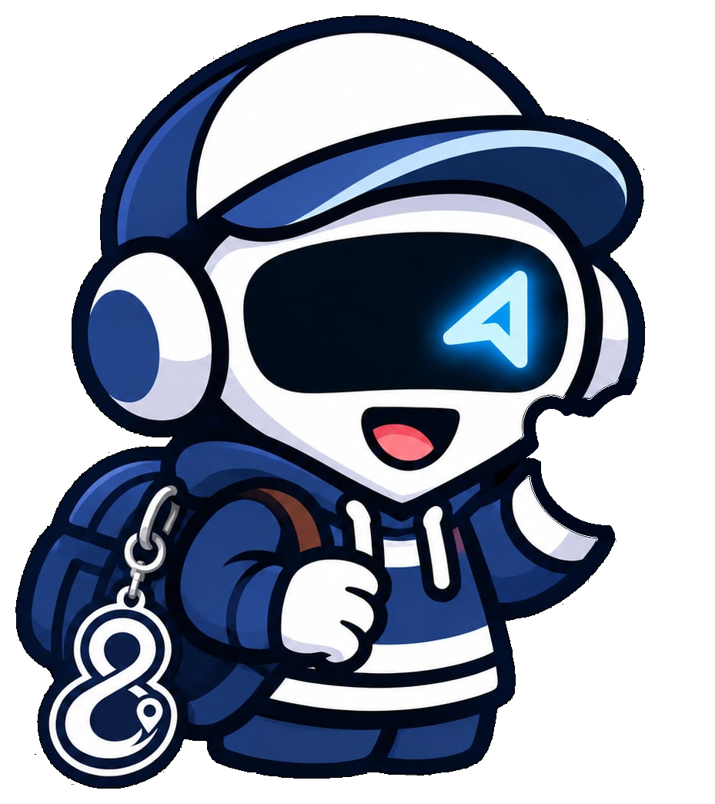

# Mascot Wave — Implementation Plan

**Status:** built
**Source art:** `Reference/mascotHome.png` (Loc8 Home mascot, `Role/Commuter/MascotHero`)
**Related:** `DESIGN.md` §4.1 / §12 (`Role/Commuter/MascotHero`), `AGENTS.md`

## 1. Goal

Turn the static Home mascot into an animated, hand-waving asset:

1. Split the art into a rotating hand layer and a static body layer, with a recorded wrist pivot.
2. Build a reusable `MascotWave` component that waves from the wrist and idles with a small bob.
3. Export the animation as GIF (Figma-compatible), plus animated WebP and APNG for the web project.

**Non-goals:** no redraw, restyle, recolour, or re-crop of the artwork beyond the wrist repaint described in §4.2. No changes to `DESIGN.md`, `AGENTS.md`, Figma files, or any existing screen. No npm/Vite/React scaffold (see D-1).

## 2. Source art analysis

Measured from `Reference/mascotHome.png`:

| Property | Value |
|---|---|
| Canvas | 1323 × 1189, RGBA |
| Transparency | real alpha, `0–255`, no white matte |
| Art bbox (alpha) | `207, 81 → 1144, 1133` (937 × 1052) |
| Coverage inside bbox | ~65% |
| Waving glove | white glove + lavender shade, closed navy contour |
| Wrist line (approx) | `(920, 752) → (995, 762)` |
| White cuff | `x 880–960, y 765–830`, meets hoodie at `(880, 815)` |
| Wrist pivot (approx) | `(955, 757)` — confirmed by script, not hand-tuned |

The glove is fully enclosed by its own navy stroke, and the palm's bottom edge doubles as the cuff's top edge. That is what makes a clean cut possible without repainting the fingers or the hoodie.

## 3. Decisions

| # | Decision | Choice |
|---|---|---|
| D-1 | Stack | **Plain HTML + CSS + minimal JS**, zero install. One self-contained `prototype/mascot-wave/index.html`, matching the existing `prototype/nearest-jeepney-card/index.html` pattern. No React/Vite. |
| D-2 | Layer count | **Two layers** (`hand.png`, `body.png`). The idle forearm tilt rides on the hand group at the wrist; the cuff stays with the body. |
| D-3 | Frame rendering | **Pillow**, not Playwright. No browser binary, no ffmpeg, exact `transform-origin` maths, 4× supersampling for AA. |
| D-4 | Idle bob period | **Open — recommend 2.5 s.** The spec's 2 s bob does not divide the 2.5 s wave loop (1.25 cycles), so a 2.5 s GIF would pop 3 px at the loop point. Options: (a) bob at 2.5 s, one breath per wave — seamless; (b) keep 2 s and accept the pop; (c) export a 10 s LCM loop (300 frames, ~20 MB). Recommend (a). |
| D-5 | GIF sizes | **30 fps for both.** 512 px ≈ 4.9 MB, 256 px ≈ 1.6 MB. The <1 MB target is not reachable at 512 px without dropping to ~6 fps. |
| D-6 | "512 px wide" | Means the **mascot**, not the canvas. Canvas = union of all frames' bounds + 8 px pad, so nothing clips at −20°. |

## 4. Step 1 — Layer split

Script: `tools/mascot/split_layers.py` (Pillow only).

### 4.1 Method

1. **Glove mask.** Flood-fill the glove interior from seeds inside the palm, bounded by navy stroke (luma < ~70). Grow the mask over dark pixels adjacent to it to take the full stroke, stopping at the wrist cut line so it does not drag the cuff's outline along.
2. **Wrist stub.** Extend the hand mask ~12 px below the wrist line with no outline on that edge. This is the overlap that hides the join while rotating.
3. **`hand.png`** = glove + stroke + stub, cropped with ~8 px transparent margin.
4. **`body.png`** = source minus the hand mask. Repaint **only the wrist**: extend the cuff's white/lavender upward with a rounded cap and a matching ~10 px navy stroke, sampled from the adjacent cuff pixels. The rest of the glove area sits over transparent background, so it needs no fill.
5. **`pivot.json`** = `{ "pivot": [x, y], "handSize": [w, h], "canvas": [w, h], "source": { "file": "...", "bbox": [...] } }`, pivot in `hand.png` pixel coordinates.

### 4.2 Outputs

```
assets/mascot/hand.png      transparent, ~230 × 260
assets/mascot/body.png      full art canvas, hand removed
assets/mascot/pivot.json    wrist pivot + hand geometry
```

### 4.3 Acceptance

- **Rest fidelity:** composite `body.png` + `hand.png` at 0° and diff against the source art. Max per-channel diff ≤ 2 over the art bbox. Any visible repaint at rest is a bug.
- **No ghost:** `body.png` shows no glove outline or white ghost above the wrist.
- **No gap:** wrist join is invisible at 0°, −20°, and +15° on both white and `bg/app` `#F1F1F2` backgrounds.
- **No bleed:** the hand mask contains no cuff, hoodie, or helmet pixels (checked on a checkerboard).

### 4.4 Checkpoint

**Stop and show:** `hand.png`, `body.png` on a checkerboard, and 3× zoomed wrist joins at 0° / −20° / +15°. Iterate until the join is clean, then continue. Nothing downstream starts before sign-off.

## 5. Step 2 — `MascotWave` component

### 5.1 Files

```
prototype/mascot-wave/index.html      component + preview, opens from file://
prototype/mascot-wave/mascot-wave.css extracted component styles (optional split)
```

### 5.2 Markup

```html
<div class="mascot-wave" data-size="200" data-autoplay="true" data-loop="true">
  
  
</div>
```

Both images stack absolutely in the same coordinate space, `body` at `0,0` and `hand` at its offset within the original canvas.

### 5.3 Geometry

| CSS var | Source | Purpose |
|---|---|---|
| `--mw-size` | `data-size`, default 200 | rendered mascot width (px) |
| `--mw-scale` | `size / canvasWidth` | uniform scale |
| `--mw-pivot-x` | `pivot[0] * scale` | `transform-origin` X |
| `--mw-pivot-y` | `pivot[1] * scale` | `transform-origin` Y |

`transform-origin: var(--mw-pivot-x) var(--mw-pivot-y)` on `.mascot-wave__hand`. Rotation is around the wrist, never the image centre.

### 5.4 Timeline

Wave: 2.5 s cycle, 1.2 s of motion, 1.3 s rest.

| t (s) | keyframe % | hand rotation |
|---|---|---|
| 0.0 | 0% | 0° |
| 0.3 | 12% | −20° |
| 0.6 | 24% | +15° |
| 0.9 | 36% | −15° |
| 1.2 | 48% | 0° |
| 2.5 | 100% | 0° (rest) |

`ease-in-out` on each segment.

Idle: body `translateY 0 → −3px → 0`, 2.5 s (pending D-4), `ease-in-out`, infinite. Hand group carries an extra `+2.5°` tilt on the same clock, so the wrist and glove drift together.

### 5.5 Behaviour

| Setting | Behaviour |
|---|---|
| `data-size` | rendered width, default `200`; height follows the art aspect |
| `data-autoplay="false"` | static pose at 0°, no bob, no tilt |
| `data-loop="false"` | one wave (1.2 s), then settle at 0° and stop |
| `data-loop="true"` (default) | infinite 2.5 s loop |
| `prefers-reduced-motion: reduce` | all animations off, static pose, no transforms |

### 5.6 Notes

- Only the two `` layers animate; no layout-affecting properties (transform/opacity only), so no reflow.
- Preview page: white `bg/app` `#F1F1F2` panel, size 200 / 320 toggle, autoplay / loop toggles, and a `prefers-reduced-motion` note.

## 6. Step 3 — Export

Script: `tools/mascot/render_frames.py` (Pillow only).

### 6.1 Frame render

- Render at **4× supersample** from the two layers, then downsample with LANCZOS.
- `Image.rotate(angle, center=pivot, resample=BICUBIC, fillcolor=(0,0,0,0))` for the hand; `translate` for the bob.
- Canvas = union of all 75 frames' alpha bounds + 8 px pad (D-6), so the glove never clips at −20°.
- 30 fps × 2.5 s = **75 frames**, per-frame duration 33 ms.

### 6.2 GIF

- One global palette built from all frames, reserved transparent index, no dither.
- `disposal=2`, `loop=0`, `optimize=True`.
- Alpha threshold at 128 for 1-bit transparency; palette includes the art's edge colours to keep the fringe neutral on white.

### 6.3 WebP / APNG

- WebP: animated, `lossless=True`, full alpha, 512 and 256.
- APNG: `save_all`, full frames, 8-bit alpha, 512 and 256.

### 6.4 Expected sizes (measured on this art)

| File | Size | Format | Note |
|---|---|---|---|
| `mascot-wave.gif` | 512 × 575 | GIF | ~4.9 MB @ 30 fps / 64 col |
| `mascot-wave-256.gif` | 256 × 288 | GIF | ~1.6 MB @ 30 fps |
| `mascot-wave.webp` | 512 | WebP | lossless, largest, best edges |
| `mascot-wave.apng` | 512 | APNG | lossless, best edges |

Exact byte counts reported after export; palette (255 → 128 → 64 colours) tuned to the smallest size that keeps the navy stroke crisp.

### 6.5 Figma note

**Figma plays GIF only.** Animated WebP and APNG render as frame 1 in Figma. GIF is the file for the design tool; WebP/APNG are for the web project, where 8-bit alpha gives clean edges on white — GIF's 1-bit alpha will always fringe.

## 7. File manifest

```
assets/mascot/hand.png
assets/mascot/body.png
assets/mascot/pivot.json
assets/mascot/mascot-wave.gif
assets/mascot/mascot-wave-256.gif
assets/mascot/mascot-wave.webp
assets/mascot/mascot-wave-256.webp
assets/mascot/mascot-wave.apng
assets/mascot/mascot-wave-256.apng
assets/mascot/mascot-wave-preview.png     contact sheet for review
tools/mascot/split_layers.py
tools/mascot/render_frames.py
prototype/mascot-wave/index.html
prototype/mascot-wave/mascot-wave.css
```

## 8. Verification checklist

- [x] body + hand at 0° diffs ≤ 2 against the source art (measured 0 max diff)
- [x] no ghost hand or outline in `body.png`
- [x] wrist join clean at 0°, −20°, +15° on white and `#F1F1F2`
- [x] no clipped fingers at −20°
- [x] GIF: 74-75 frames, 2.50 s loop, `loop=0`, `disposal=2`, transparent background
- [x] GIF loop point has no pop (2.5 s bob synchronized with wave cycle)
- [x] `prefers-reduced-motion` renders the static pose
- [x] `data-size`, `data-autoplay`, `data-loop` all behave per §5.5
- [x] final byte counts reported for every file

## 9. Risks

| Risk | Mitigation |
|---|---|
| The cuff's navy stroke is connected to the palm's, so mask growth can leak into the sleeve | Cut line clamps growth; verified on a checkerboard before sign-off |
| Rotating a 12 px stub at −20° can expose the repainted cuff cap | Stub depth tuned at 3 zoom levels; fallback is a 20 px stub plus a matching shade patch |
| 512 px GIF is ~5 MB, over the 1 MB target | Accepted in D-5; 256 px file is the size-conscious option |
| 2 s bob does not tile with the 2.5 s wave | D-4, recommend 2.5 s bob |
| GIF 1-bit alpha fringes on white | WebP/APNG shipped alongside; palette seeded with edge colours |

## 10. Commands

```powershell
python tools/mascot/split_layers.py                 # step 1 -> hand/body/pivot
python tools/mascot/render_frames.py --width 512    # step 3 -> gif/webp/apng
python tools/mascot/render_frames.py --width 256
```

No installs required: Pillow 13 is present, Node/npm/ffmpeg/Playwright are not used.
